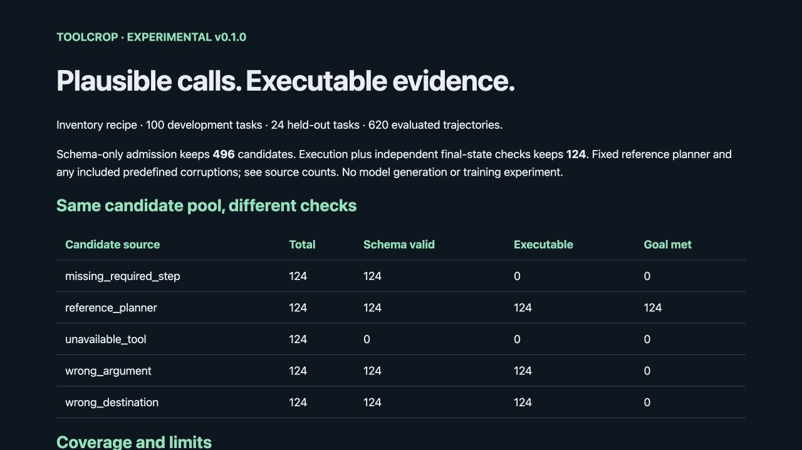

# ToolCrop

**Generate tool-use examples and keep the ones that execute correctly.**

ToolCrop is an experimental, attributed fork of [Bespoke Labs Curator](https://github.com/bespokelabsai/curator). It preserves Curator's synthetic-data and bulk-inference library and adds one complete execution-filtered dataset recipe. The first environment is a tiny inventory simulator: reserve stock, ship it to the requested dock, or release a hold.

A tool call can be well-formed and execute without errors while still doing the wrong thing. ToolCrop checks the independently specified final state and required intermediate checkpoints before admitting a trajectory to its dataset.



## Quickstart

Python 3.10+; Python 3.11 is the tested release environment. No model key is needed for the deterministic demo.

```sh
git clone https://github.com/grishahq/toolcrop.git
cd toolcrop
git checkout v0.1.0
python -m venv .venv
. .venv/bin/activate
python -m pip install .
toolcrop demo --output toolcrop-output
```

Open `toolcrop-output/report.html`. The release wheel is also installable with `python -m pip install /path/to/toolcrop_curator-0.1.0-py3-none-any.whl`. This installs the retained Curator dependencies. Do not install `bespokelabs-curator` alongside this fork: both distributions own the same Curator namespace.

For the standard-library-only offline recipe directly from the checkout, `PYTHONPATH=src python -m toolcrop demo --output toolcrop-output` works without installing provider packages. That path does not install Curator's provider integrations.

## What the demo actually measures

The fixed task registry has 100 development tasks and 24 held-out tasks with disjoint item IDs, tool names and argument keys. It covers single shipments, split shipments and hold/release requests. A deterministic reference planner proposes one trajectory per task. Four predefined changes create negative examples: wrong reservation quantity, missing reservation step, unavailable tool and wrong destination (or a shipment substituted for a release).

| Same 620 candidates | Admitted |
| --- | ---: |
| Strict tool schema validation | 496 |
| Schema validation + error-free execution | 372 |
| Execution + independent goal/checkpoint validation | 124 |

All 100 development references and 24 held-out references pass; all 496 controlled corruptions are rejected. Development acceptance is 100/500 (20%), executable success is 300/500 (60%), and accepted task coverage is 100/100. Held-out acceptance is 24/120 (20%), executable success is 72/120 (60%), and accepted task coverage is 24/24. These denominators include deliberately injected faults. They are not estimates of a model's success rate.

The held-out schema is supported explicitly by the reference planner. It tests pipeline behavior on a separate schema, not learned generalization. These are small templated fixtures with no model API calls, training experiment, quality gain, production-safety guarantee or adoption claim. Counts are descriptive, not independent statistical trials. See the [methodology and data card](toolcrop_docs/DATA_CARD.md).

## Validate your own proposed trajectories

A candidate cannot supply or overwrite its own goal. Import JSONL rows containing **exactly** `task_id` and `calls` against the selected trusted split:

```json
{"task_id":"development-000","calls":[{"name":"reserve","arguments":{"sku":"DEV-000","quantity":1}},{"name":"ship","arguments":{"sku":"DEV-000","quantity":1,"destination":"DEV-DOCK-0"}}]}
```

```sh
toolcrop validate toolcrop_docs/candidates.example.jsonl --output checked
# Held-out evaluation is explicit; keep it separate from prompt development:
toolcrop demo --split heldout --output heldout-check
```

`validate` returns an error for invalid file structure or an unknown task. Individual invalid trajectories are retained as rejected records with reasons; the command succeeds when evaluation/export completes, even if all candidates are rejected. Check `report.json` for acceptance. It does not overwrite a remote dataset or train a model.

The executor exposes a finite dispatch table over private in-memory dictionaries. It never evaluates generated code, imports a proposed tool, or exposes network, filesystem or shell operations. Inputs are bounded to 32 calls, 1–1000 units per call, 80-character strings, and a 10 MB / 10,000-row import file. This is a contained toy environment, not an OS sandbox for arbitrary tools.

## Use Curator to propose candidates

Curator's original `bespokelabs.curator.LLM`, provider integrations, viewer and examples remain available. The new adapter uses Curator's structured output and generation pipeline while keeping the trusted goal out of generation input and caches:

```python
from toolcrop.curator_recipe import generate_and_evaluate
from toolcrop.pipeline import export

records = generate_and_evaluate("gpt-4o-mini", split="development", limit=10)
export(records, "model-candidates")
```

Configure the provider's API credentials separately. Curator can probe rate limits during construction. Live generation was **not** measured for this release; adapter validation uses the real Curator class with provider IO stubbed. The adapter proposes a whole multi-step sequence; reactive model rollout with execution feedback is a future improvement. Choose a provider/model supported by your configuration; model names here follow the retained upstream example, not a new model recommendation.

## Dataset and report files

- `candidates.jsonl`, `accepted.jsonl`, `rejected.jsonl`: real execution traces, initial/final state, source, split and rejection reasons.
- `development.chat.jsonl`, `heldout.chat.jsonl`: accepted trajectories separated by split, with tool schemas, initial-state metadata and actual tool results. Generic chat records require conversion for a particular training provider; preserve initial-state context and never combine held-out records into training.
- `report.json`, `report.html`: schema validity, executability, acceptance, unique-task/family coverage and limits.
- `checksums.json`: SHA-256 digests of the deterministic output files.

The release includes a downloadable fixture bundle. Inspect rejected examples before using synthetic data for training. The dataset is intended as a recipe and validation fixture, not a large or diverse training corpus.

## Reproduce validation

```sh
python -m pip install pytest pytest-asyncio vcrpy pytest-timeout pytest-dependency ruff
TELEMETRY_ENABLED=false CURATOR_VIEWER=false python -m pytest recipe_tests \
  tests/unittests/test_prompt_formatter.py tests/unittests/test_dataset_conversion.py \
  tests/unittests/test_namespace.py tests/unittests/test_db_schema.py -q
ruff check src/toolcrop recipe_tests --select E,F,I,B
ruff format src/toolcrop recipe_tests --check
python -m toolcrop demo --output reproduced
# Compare reproduced/checksums.json with evidence/inventory-v1/checksums.json
```

CI runs this offline subset. Full upstream integration/GPU/provider suites were not run. The original workflow is retained for reference in `toolcrop_docs/UPSTREAM_CI.yaml`. [Validation evidence](evidence/README.md) records the tested scope, review and clean artifact installation.

## Attribution, roadmap and maintenance

Curator already supplied structured outputs, caching/retries, function-calling examples and multi-turn conversations. Those are upstream capabilities, not ToolCrop inventions. The new work is the independently specified inventory recipe, bounded executor, state/checkpoint validation, corruption experiment, audit exports and reports.

Upstream baseline: [`7fa08c5207c3b1fd5c1d0f15f1dc25a6547a3d8a`](https://github.com/bespokelabsai/curator/commit/7fa08c5207c3b1fd5c1d0f15f1dc25a6547a3d8a). [Original README](toolcrop_docs/UPSTREAM_README.md), [attribution](toolcrop_docs/UPSTREAM.md), [LICENSE](LICENSE), [NOTICE](NOTICE). This fork is not an official Bespoke Labs release.

v0.1 ships one environment with offline negative cases and coverage included. v0.2 will expand cases/coverage and add reactive rollout; v0.3 will add a second contained environment and integrations based on external usage. [Implementation plan](IMPLEMENTATION_PLAN.md) includes acceptance criteria and maintenance strategy. Report false accepts/rejects with a minimal task/candidate fixture through GitHub issues. Published tags will not be rewritten.
